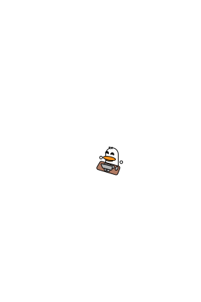

<div align="center">

# 🦆 Bongo Duck — Seu Desktop Pet de Produtividade


### Um companheiro virtual para desktop com Pomodoro integrado, animações vetoriais e alertas sonoros.

[](https://www.rust-lang.org/)
[](https://github.com/Luirafa2020/Bongo-Duck/releases)
[](LICENSE)
[](https://github.com/Luirafa2020/Bongo-Duck/releases)

</div>

---

## 📖 Sobre o Projeto

O **Bongo Duck** é um desktop pet leve e personalizável feito em **Rust** com a biblioteca gráfica **egui/eframe**. Inspirado no clássico *Bongo Cat*, ele fica flutuando na sua tela enquanto você estuda ou trabalha, ajudando você a manter o foco através da técnica **Pomodoro**.

A janela é transparente, sem bordas e configurada para ficar **sempre no topo** (*Always on Top*), acompanhando seu fluxo de trabalho sem atrapalhar suas tarefas.

---

## ✨ Funcionalidades

- 🍅 **Temporizador Pomodoro**: Ciclos configurados de **25 minutos de Foco** e **5 minutos de Pausa**.
- ⌨️ **Animação Bongo Cat**: O pato digita alternando as patinhas no teclado e no mouse durante o tempo de foco.
- 😴 **Modo Sesta (Descanso)**: Durante a pausa, ele fecha os olhos para dormir com efeito animado de `Zzz...` e gotinha no bico.
- 🥰 **Interação e Carinho**: Clique nele para fazer carinho! Ele solta corações flutuantes e frases de incentivo.
- 🔊 **Alerta Sonoro (`quack.mp3`)**: Toca um alerta sonoro exclusivo sempre que um ciclo Pomodoro termina.
- 🎨 **Gráficos 100% Vetoriais (SVG)**: Renderização nítida em qualquer resolução (Full HD, Quad HD e 4K).
- 🖱️ **Controle Dinâmico de Tamanho**: Passe o mouse sobre o pato e role o *scroll* para aumentar ou diminuir o tamanho dele em tempo real.
- 📌 **Arraste Livre**: Clique e arraste o patinho para posicioná-lo em qualquer canto do monitor.

---

## 🎭 Poses do Pato

| Parado (Idle) | Digitando (Foco) | Carinho (Clique) | Dormindo (Pausa) |
| :---: | :---: | :---: | :---: |
|  |  |  |  |
| *Aguardando início* | *Trabalhando a todo vapor* | *Recebendo carinho* | *Descanso merecido* |

---

## 📥 Downloads (Binários Prontos)

Baixe a versão mais recente diretamente na aba de [**Releases**](https://github.com/Luirafa2020/Bongo-Duck/releases):

### 🐧 Linux (AppImage)
Compatível com Fedora, Ubuntu, Debian, Arch Linux e qualquer distribuição moderna:
1. Baixe o arquivo **`BongoDuck-x86_64.AppImage`**.
2. Dê permissão de execução:
   ```bash
   chmod +x BongoDuck-x86_64.AppImage